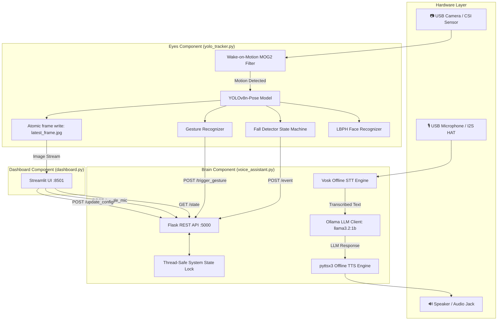
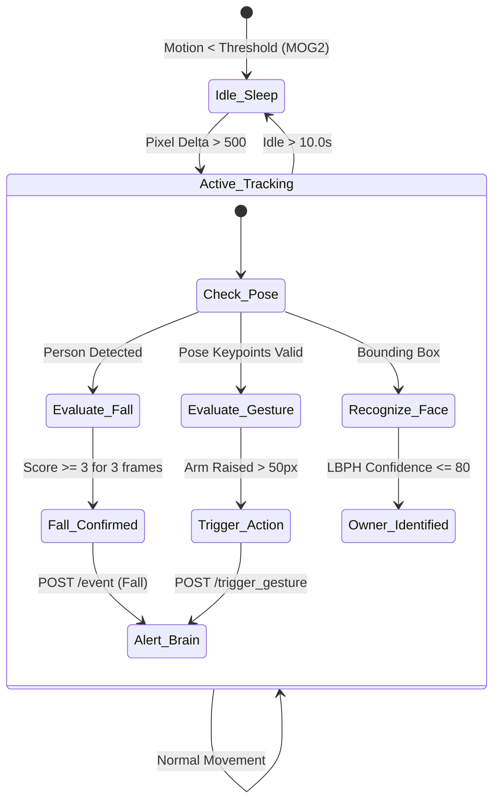
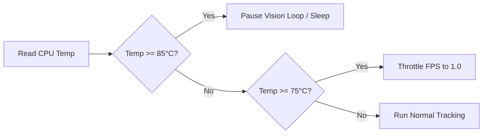

# 🤖 Ambient AI Hub — Complete Technical Documentation

> [!abstract] Executive Summary
> **Ambient AI Hub** is a privacy-first, fully offline edge artificial intelligence assistant designed specifically for single-board computers like the **Raspberry Pi 4 / Pi 5**. It integrates local Speech-to-Text (STT), a quantized local LLM, offline Text-to-Speech (TTS), computer vision pose estimation (YOLOv8n-pose), LBPH facial recognition, fall detection, and gesture control into a hardened microservice architecture. **No cloud APIs are required and no data leaves the device.**

---

## 📌 Quick Navigation Table of Contents

- [[#🏗️ System Architecture & Data Flow]]
- [[#📁 File & Component Inventory]]
- [[#🧠 Brain Microservice voice_assistant.py]]
- [[#👁️ Eyes Microservice yolo_tracker.py]]
- [[#📊 Telemetry Dashboard dashboard.py]]
- [[#⚙️ Central Configuration config.yaml]]
- [[#📡 REST API Specification]]
- [[#🛡️ Hardening Audit & Bugfix Catalogue AUDIT.md]]
- [[#🚀 Installation & Deployment Guide]]
- [[#🛠️ Systemd Service Management]]
- [[#🌡️ Thermal Guardrails & Performance Optimization]]
- [[#🧪 Testing & Hardware Verification]]
- [[#❓ Troubleshooting Matrix]]

---

## 🏗️ System Architecture & Data Flow

> [!info] Architectural Paradigm
> The system operates as three decoupled microservices communicating locally over loopback HTTP REST interfaces and atomic shared file buffers:
> 1. **Brain (`voice_assistant.py`)**: Audio I/O pipeline + Flask REST Controller + Ollama LLM driver.
> 2. **Eyes (`yolo_tracker.py`)**: OpenCV video pipeline + YOLOv8 pose estimator + LBPH face classifier + Fall/Gesture state machines.
> 3. **Dashboard (`dashboard.py`)**: Streamlit web application providing live video telemetry, state controls, and gesture bindings.



---

## 📁 File & Component Inventory

> [!note] Project Structure
> Below is the complete catalogue of core components, models, scripts, and test suites in the workspace.

| File Path | Purpose | Key Responsibilities & Functions |
| :--- | :--- | :--- |
| `voice_assistant.py` | Brain Engine & API | Vosk STT thread, non-blocking TTS daemon, Ollama LLM integration, Flask REST server (:5000), thread-safe state management (`_state_lock`). |
| `yolo_tracker.py` | Eyes & Vision Engine | Frame capture loop, MOG2 wake-on-motion background subtraction, YOLOv8 pose keypoint extraction, LBPH face classification, fall score calculation, atomic JPEG frame serialization (`latest_frame.jpg`). |
| `dashboard.py` | Web Telemetry UI | Streamlit dashboard (:8501), real-time camera feed render, system metrics view, mic mute toggle, fall alert cancellation countdown, dynamic gesture mapping controls. |
| `enroll_owner.py` | Owner Enrollment | One-shot OpenCV webcam sampler for owner face capture (50 grayscale frames), Haar cascade face cropping, LBPH model training (`owner_face_model.yml`). |
| `config.yaml` | Central Config | Single source of truth for all system thresholds, ports, model paths, auth tokens, HTTP timeouts, logging policies, and thermal guardrails. |
| `setup_pi.sh` | OS Environment Setup | Idempotent shell installer for APT system libraries (espeak, portaudio, OpenCV dependencies), Python virtual environment (`.venv`), Vosk model download, and Ollama model pull. |
| `install_services.sh` | systemd Unit Provisioner | Automated installer for systemd units (`ambient-brain`, `ambient-eyes`, `ambient-dashboard`), sandboxing limits, ordering rules (`Requires=ollama.service`), and clean `--uninstall` handler. |
| `AUDIT.md` | Security & Bug Audit | Comprehensive catalogue of 33 identified system defects across Critical, High, Medium, and Low severity levels with auditor notes. |
| `CHANGELOG.md` | Fix & Hardening Record | Historical log detailing exact fixes implemented for all 33 audit findings. |
| `tests/` | QA & Soak Test Suite | 7 test modules covering Flask API validation, fall detection score math, gesture bounding logic, failure recovery, and multi-worker soak testing. |

---

## 🧠 Brain Microservice (`voice_assistant.py`)

> [!tip] Non-Blocking Audio Architecture
> To eliminate audio blocking and feed-back loops, `voice_assistant.py` employs dedicated daemon worker threads:
> - **STT Thread**: Continuously captures 16kHz PCM audio streams from `sounddevice` and feeds audio blocks into the Vosk engine.
> - **TTS Worker Thread**: Receives speak jobs from a thread-safe Queue (`_tts_queue`). Flushes the mic audio queue before and after speaking to prevent the assistant from hearing its own voice output (**Echo Loop Prevention - C-5**).
> - **Ollama LLM Worker**: Executes prompts asynchronously with a configurable timeout (`ollama_timeout_s: 15`).

### Key Functions & Specifications
- `_call_ollama(prompt: str) -> str`: Sends request to local Ollama server running `llama3.2:1b`. Supports both legacy dict outputs and SDK v0.2+ `Message` objects.
- `speak(text: str)`: Non-blocking enqueue function for text synthesis.
- `audio_callback(...)`: Captures mic blocks and enqueues them for Vosk parsing unless `is_muted` or `_is_speaking` flags are active.

---

## 👁️ Eyes Microservice (`yolo_tracker.py`)

> [!important] Vision State Machine & Fall Detection Logic
> The vision component relies on keypoint analysis derived from **YOLOv8n-pose** (17 COCO body keypoints).

### Keypoint Indices (COCO Standard)
- `0`: Nose | `5-6`: Shoulders (Left/Right) | `11-12`: Hips (Left/Right) | `15-16`: Ankles (Left/Right)



### Fall Score Calculation
Fall detection evaluates three weighted geometric criteria:
1. **Bounding Box Aspect Ratio ($W/H > 1.2$)**: Indicates a horizontal body orientation (+1 point).
2. **Head-to-Hip Vertical Offset ($\Delta Y_{\text{nose-hip}} < 0.15 \times H$)**: Indicates head is level with hips (+1 point).
3. **Ankle Level Proximity ($\text{Y}_{\text{hip}} \approx \text{Y}_{\text{ankle}}$)**: Indicates hips are down on the floor level (+1 point).

> [!check] Fall Confirmation Threshold
> If the cumulative score is $\ge 3$ for `fall_confirm_frames` consecutive frames (default 3), a fall alert is dispatched to the Brain service with exponential HTTP backoff retries.

---

## 📊 Telemetry Dashboard (`dashboard.py`)

> [!note] Streamlit Web UI
> Accessible on port `8501` across the local network. Provides a real-time monitor for system health, live vision overlay, owner identification status, emergency fall cancellation controls, and custom gesture mapping.

### Key Capabilities
- **Live Frame Render**: Reads `latest_frame.jpg` via atomic replacement to prevent visual artifacts or torn frames.
- **Fall Cancellation Banner**: Displays an active 8-second countdown timer when a fall is detected, allowing single-click or voice cancellation ("I'm okay").
- **Dynamic Gesture Configuration**: Allows remapping gesture triggers (e.g., Left Arm Raised $\rightarrow$ Toggle Mic, Right Arm Raised $\rightarrow$ Toggle Light) without restarting microservices.

---

## ⚙️ Central Configuration (`config.yaml`)

> [!tip] Single Source of Truth
> All numeric constants, thresholds, paths, timeouts, and network settings are stored in `config.yaml`.

```yaml
# Network Settings
brain_api_host: "127.0.0.1"      # Loopback binding for security
brain_api_port: 5000
dashboard_port: 8501
api_secret_token: "74bc7320ae1b6c2c0013e2615a17bf2c1ef43e94855a5e69f8153f59fd58c879"

# Models
yolo_model: "yolov8n-pose.pt"
vosk_model: "vosk-model-small-en-us-0.15"
ollama_model: "llama3.2:1b"
face_model_path: "owner_face_model.yml"

# Fall Detection Parameters
fall_confirm_frames: 3            # Consecutive frames before alert
fall_alert_cooldown_s: 30         # Cooldown between alerts
fall_score_threshold: 3           # Required score threshold
fall_cancel_countdown_s: 8        # Cancellation window

# Face Recognition
lbph_confidence_threshold: 80     # Lower = stricter match

# Wake-on-Motion (MOG2)
motion_sleep_timeout_s: 10.0
motion_pixel_threshold: 500
mog2_history: 500

# Thermal Safety Limits
cpu_throttle_temp_c: 75           # Drop to 1 FPS above this temp
cpu_pause_temp_c: 85              # Pause vision engine entirely
```

---

## 📡 REST API Specification

> [!important] Security Requirements
> All state mutation endpoints (`POST`) require authorization via the `X-Secret-Token` HTTP header matching `api_secret_token` from `config.yaml`. Requests exceeding 4096 bytes are automatically rejected (`413 Payload Too Large`).

| Endpoint | Method | Auth Required | Description | Request Payload | Response Schema |
| :--- | :---: | :---: | :--- | :--- | :--- |
| `/health` | `GET` | No | Liveness & readiness check | None | `{"status": "ok", "service": "brain"}` |
| `/state` | `GET` | No | Fetch current system state | None | `{"is_muted": bool, "owner_present": bool, "fall_alert": bool, ...}` |
| `/toggle_mic` | `POST` | **Yes** | Toggle microphone mute state | Optional: `{"mute": bool}` | `{"status": "success", "is_muted": bool}` |
| `/event` | `POST` | **Yes** | Ingest vision events (fall/face) | `{"event_type": "fall_detected", "score": 3}` | `{"status": "acknowledged"}` |
| `/trigger_gesture`| `POST` | **Yes** | Execute action bound to gesture | `{"gesture": "left_arm_raised"}` | `{"status": "executed", "action": str}` |
| `/update_config` | `POST` | **Yes** | Whitelist-validated dynamic config update | `{"key": "gesture_left_arm", "value": "toggle_mic"}` | `{"status": "updated"}` |
| `/cancel_fall` | `POST` | **Yes** | Cancel active fall emergency state | None | `{"status": "cancelled"}` |

---

## 🛡️ Hardening Audit & Bugfix Catalogue (`AUDIT.md`)

> [!danger] Audit Summary
> Prior to deployment, a comprehensive senior engineering security and stability audit identified **33 defects**. All 33 items have been resolved and verified.

### Critical Fix Highlights

> [!warning] C-1: Unbound Variable Crash (`yolo_tracker.py`)
> **Defect**: `this_person_falling` was initialized inside the bounding box loop, causing a `NameError` crash whenever no humans were in frame.
> **Fix**: Explicitly initialized `this_person_falling = False` prior to object loop evaluation.

> [!warning] C-2: Unauthenticated LAN Binding (`voice_assistant.py`)
> **Defect**: Flask API bound to `0.0.0.0` with zero authentication exposed device control to local network.
> **Fix**: Restricted API binding to `127.0.0.1` and implemented `X-Secret-Token` header verification.

> [!warning] C-3: Thread Race Conditions (`voice_assistant.py`)
> **Defect**: Shared dictionary `system_state` mutated concurrently from Flask threads and speech loops without synchronization.
> **Fix**: Enforced thread safety across all state read/write operations using `threading.Lock()` (`_state_lock`).

> [!warning] C-4: Torn Image Frame Reads (`yolo_tracker.py`)
> **Defect**: Direct non-atomic `cv2.imwrite()` allowed Streamlit UI to read corrupt partial JPEG buffers.
> **Fix**: Implemented atomic writes by serializing frames to `.latest_frame.jpg.tmp` followed by immediate `os.replace()`.

> [!warning] C-5: STT Echo Feedback Loop (`voice_assistant.py`)
> **Defect**: Speaker output was picked up by the microphone, creating endless self-triggering feedback loops.
> **Fix**: Audio input queues are flushed immediately before TTS audio synthesis starts and after it completes.

---

## 🚀 Installation & Deployment Guide

### Prerequisites
- **Hardware**: Raspberry Pi 4 (4GB+) or Pi 5 running Raspberry Pi OS (64-bit).
- **Peripherals**: USB Microphone, USB Webcam (720p+), Speaker.

### Step 1: Clone Repository & Configure Token
```bash
git clone https://github.com/your-username/pi_ambient_ai.git ambient_ai
cd ambient_ai

# Generate a secure 64-character secret token
python3 -c "import secrets; print(secrets.token_hex(32))"
```
Update `config.yaml` with the generated secret token.

### Step 2: Run Automated Dependency Setup
```bash
chmod +x setup_pi.sh
./setup_pi.sh
```
This script provisions virtual environment `.venv/`, installs system dependencies, downloads Vosk STT models (~40MB), and pulls the Ollama `llama3.2:1b` LLM.

### Step 3: Enroll Owner Face
```bash
source .venv/bin/activate
python3 enroll_owner.py
```
Stand in front of the webcam. The script captures 50 face samples and compiles `owner_face_model.yml`.

---

## 🛠️ Systemd Service Management

> [!tip] Service Architecture
> Background persistence is handled via systemd units with resource quotas, automatic restart logic (`Restart=on-failure`), and dependency ordering (`Requires=ollama.service`).

### Installing Services
```bash
sudo ./install_services.sh
```

### Systemctl Management Commands
```bash
# Check service statuses
sudo systemctl status ambient-brain ambient-eyes ambient-dashboard

# Start all microservices
sudo systemctl start ambient-brain ambient-eyes ambient-dashboard

# Stop all microservices
sudo systemctl stop ambient-brain ambient-eyes ambient-dashboard

# Inspect live aggregated logs
journalctl -u ambient-brain -u ambient-eyes -u ambient-dashboard -f
```

---

## 🌡️ Thermal Guardrails & Performance Optimization

> [!warning] Passive Thermal Management
> High-load computer vision on Raspberry Pi hardware can lead to thermal throttling or sudden shutdown. `yolo_tracker.py` actively reads `/sys/class/thermal/thermal_zone0/temp` and adjusts performance dynamically:



- **$\text{Temp} < 75^\circ\text{C}$**: Full speed tracking (10–15 FPS).
- **$75^\circ\text{C} \le \text{Temp} < 85^\circ\text{C}$**: Throttle vision loop to **1 FPS** to cool down SoC.
- **$\text{Temp} \ge 85^\circ\text{C}$**: Completely **pause YOLO inference** until thermal recovery occurs.
- **RAM Disk Logging**: Log files are targeted to `/tmp/ambient_ai.log` to minimize SD card write cycles and prolong storage lifetime.

---

## 🧪 Testing & Hardware Verification

> [!check] Automated QA Test Suite
> Execute the full test suite from the virtual environment:

```bash
source .venv/bin/activate
python -m pytest tests/ -v --cov=.
```

### Test Suite Breakdown
1. `test_flask_api.py`: Validates all Brain REST routes, content-length guards, header authentication, and error codes.
2. `test_fall_detection.py`: Tests fall scoring logic, aspect ratio formulas, and frame confirmation counters.
3. `test_gesture_logic.py`: Evaluates arm-raise distance calculations and gesture cooldown timers.
4. `test_intent_and_utils.py`: Exercises regex intent parsers and audio queue helper functions.
5. `test_failure_injection.py`: Simulates network timeouts, corrupt model files, and missing endpoints.
6. `soak_test.py`: Multi-threaded stress test simulating high load for soak verification.

```bash
# Run 5-minute stress soak test
python tests/soak_test.py --duration 300 --workers 4
```

---

## ❓ Troubleshooting Matrix

| Symptom | Probable Cause | Corrective Action |
| :--- | :--- | :--- |
| **"Could not load face model"** | `owner_face_model.yml` is missing or corrupt | Execute `python3 enroll_owner.py` to rebuild model. |
| **TTS Echo Loop** | Mic picking up speaker audio | Lower speaker volume, adjust mic placement, or check `_is_speaking` queue flush logic in logs. |
| **YOLO never wakes from sleep** | MOG2 pixel threshold too high | Reduce `motion_pixel_threshold` in `config.yaml`. |
| **Ollama Request Timeout** | LLM inference exceeding deadline | Increase `ollama_timeout_s` in `config.yaml` or use smaller model quantization. |
| **High CPU Temperature (>80°C)** | Continuous YOLO inference | Ensure heat sink / fan is installed; thermal guardrail auto-throttles FPS. |
| **Dashboard "SIGNAL LOST"** | `yolo_tracker.py` stopped or failing | Verify status with `sudo systemctl status ambient-eyes`. |
| **HTTP POST 401 / 403 Forbidden** | `api_secret_token` mismatch | Ensure `X-Secret-Token` in `yolo_tracker.py` matches `config.yaml`. |

---
*Document compiled and validated for Obsidian Vault compatibility.*
