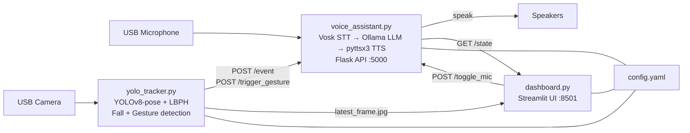

# Ambient AI Hub

> Privacy-first, fully offline smart home assistant for Raspberry Pi 4/5.
> All inference runs locally — no cloud APIs, no data leaves the device.

---

## Architecture



---

## Hardware Requirements

- Raspberry Pi 4 (4 GB RAM minimum) or Pi 5
- USB webcam (720p+)
- USB microphone (or I2S microphone HAT)
- Speaker (3.5mm or Bluetooth)
- 32 GB+ microSD card (Class 10 / A2)

---

## Quick Setup

### 1. Clone and configure

```bash
git clone <repo_url> ambient_ai
cd ambient_ai
```

Edit `config.yaml` to set your API secret token and adjust thresholds:

```yaml
api_secret_token: "YOUR_RANDOM_SECRET_HERE"
log_file: "/tmp/ambient_ai.log"   # RAM logging on Pi — no SD wear
```

### 2. Install dependencies

```bash
chmod +x setup_pi.sh
./setup_pi.sh
```

This will:
- Install system packages (`espeak`, `portaudio`, OpenCV libs)
- Create a Python virtual environment (`.venv/`)
- Install all pinned Python dependencies
- Download the Vosk STT model (~40 MB)
- Install and pull the Ollama `llama3.2:1b` model

### 3. Enroll your face

```bash
source .venv/bin/activate
python3 enroll_owner.py
```

Stand in front of the camera and move your head slightly. 50 samples are captured and saved to `owner_face_model.yml`.

### 4. Install as auto-start services

```bash
sudo ./install_services.sh
```

Three systemd services are installed:
- `ambient-brain` — Voice assistant & API
- `ambient-eyes` — Vision engine
- `ambient-dashboard` — Web UI on port 8501

Start without rebooting:
```bash
sudo systemctl start ambient-brain ambient-eyes ambient-dashboard
```

Uninstall:
```bash
sudo ./install_services.sh --uninstall
```

---

## Configuration Reference (`config.yaml`)

| Key | Default | Description |
|-----|---------|-------------|
| `brain_api_host` | `127.0.0.1` | API bind address (never change to 0.0.0.0) |
| `brain_api_port` | `5000` | Brain Flask API port |
| `api_secret_token` | `""` | Shared secret for inter-service auth |
| `ollama_model` | `llama3.2:1b` | Ollama model name |
| `ollama_timeout_s` | `15` | Max seconds to wait for LLM response |
| `fall_confirm_frames` | `3` | Consecutive frames before fall alert fires |
| `fall_alert_cooldown_s` | `30` | Seconds between repeated fall alerts |
| `fall_cancel_countdown_s` | `8` | Seconds user has to say "I'm okay" |
| `lbph_confidence_threshold` | `80` | LBPH face match (lower = stricter) |
| `gesture_cooldown_s` | `3.0` | Seconds between repeated gestures |
| `motion_sleep_timeout_s` | `10.0` | Seconds of no motion before YOLO sleeps |
| `cpu_throttle_temp_c` | `75` | Temperature to drop to 1 FPS |
| `cpu_pause_temp_c` | `85` | Temperature to pause YOLO entirely |
| `log_file` | `ambient_ai.log` | Log path (use `/tmp/` on Pi for RAM logging) |
| `dashboard_refresh_interval_s` | `1.5` | Dashboard auto-refresh interval |

---

## Gesture Controls (Configurable via Dashboard)

| Gesture | Default Action |
|---------|---------------|
| Left arm raised | Toggle microphone mute |
| Right arm raised | Toggle smart light |
| Both arms raised | Toggle smart fan |
| T-pose (arms stretched out) | (None — configurable) |

---

## Security Notes

- The Brain API is bound to `127.0.0.1` only — not accessible from the network.
- The Dashboard (`0.0.0.0:8501`) shows a live camera feed. **Restrict access** if the Pi is on an untrusted network (firewall or bind to LAN IP only).
- Set `api_secret_token` to a strong random value in `config.yaml`.
- The LBPH face recogniser has a confidence threshold — lower values reduce false positives but may miss legitimate owners in poor lighting.
- **Anti-spoofing:** The current LBPH implementation cannot detect photo spoofing. A static photo of the owner could potentially be recognised as "Owner." This is documented, not fixed — full liveness detection would require a different model stack.

---

## Troubleshooting

| Symptom | Cause | Fix |
|---------|-------|-----|
| "Could not load face model" | `owner_face_model.yml` missing | Run `python3 enroll_owner.py` |
| Assistant hears itself | Echo — mic picking up speaker | Enable echo cancellation in ALSA/PulseAudio, or reduce speaker volume |
| YOLO never wakes | `motion_pixel_threshold` too high | Lower it in `config.yaml` |
| "Ollama timed out" | Model too slow for the query | Increase `ollama_timeout_s` or use a smaller model |
| High CPU temperature | YOLO running at full speed | Thermal guardrail auto-applies; check `cpu_throttle_temp_c` |
| Dashboard shows "SIGNAL LOST" | `yolo_tracker.py` not running or `latest_frame.jpg` missing | Start the Eyes service |
| Fall alerts not arriving | Brain restarted during alert | Retry logic handles this — check logs for "POST /event failed" |

---

## Running Tests

```bash
source .venv/bin/activate
python -m pytest tests/ -v
```

For the soak test (requires Brain running):
```bash
python tests/soak_test.py --duration 300 --workers 4
```

---

## Hardware Verification Checklist

These items **cannot** be verified without physical hardware:

- [ ] Microphone STT in a real room environment
- [ ] TTS output through speakers
- [ ] Fall detection with a real person lying down
- [ ] Gesture recognition at real distances (1–3m)
- [ ] Owner face recognition under varied lighting
- [ ] Thermal guardrail triggers at real CPU temperatures
- [ ] MOG2 wake-on-motion sensitivity in a real room
- [ ] systemd service auto-restart after kill
- [ ] SD-card wear (log file rotation)
- [ ] Anti-spoofing limitations (photo test)
